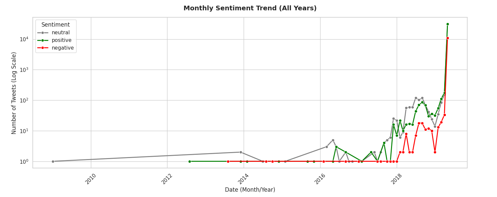
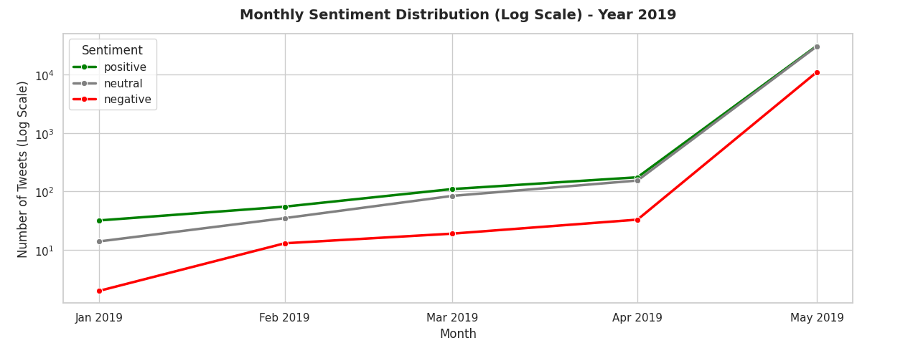
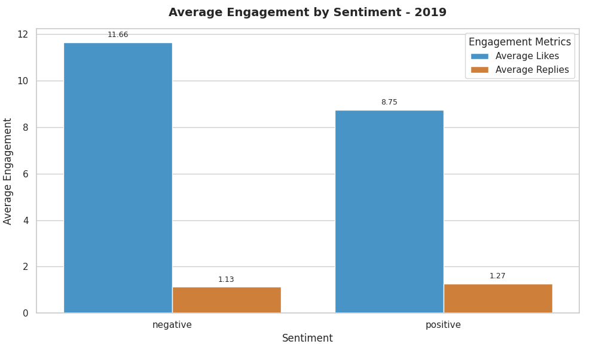
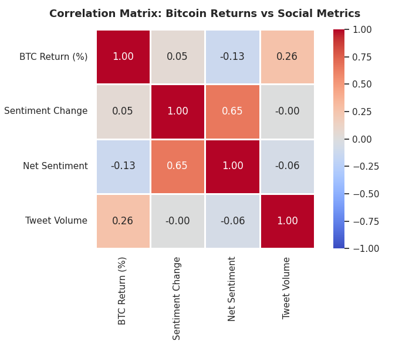
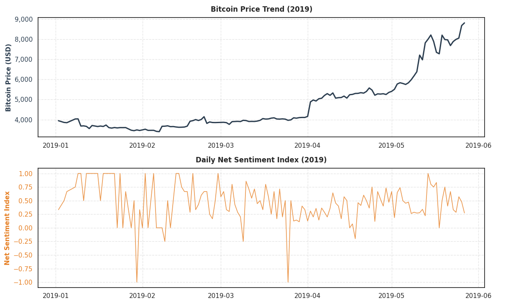
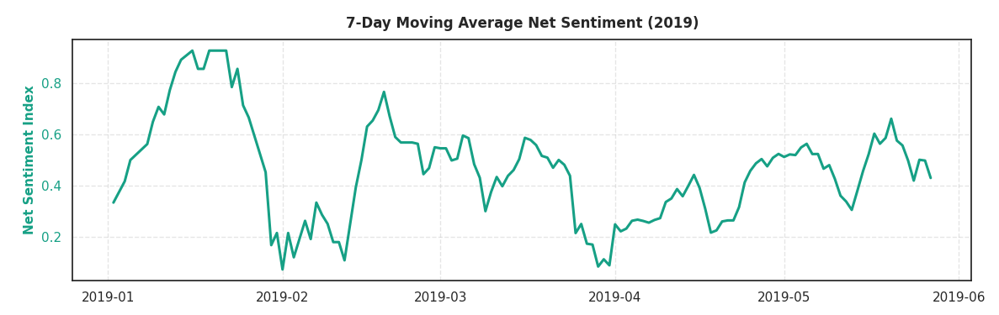
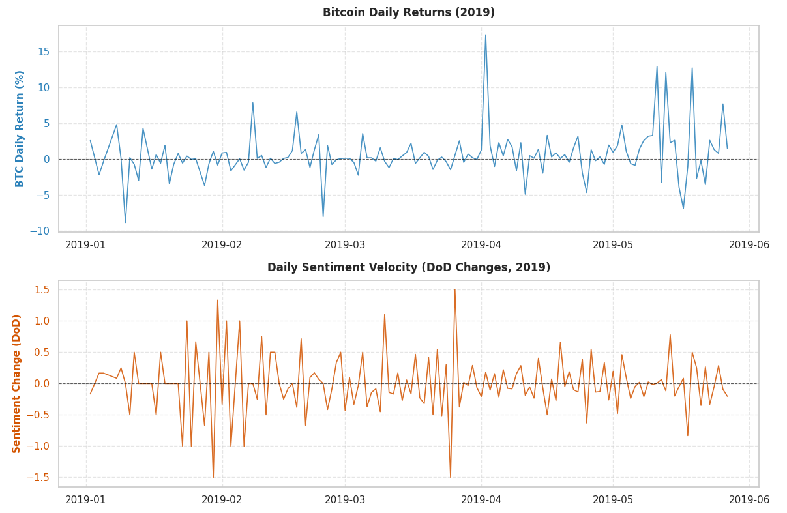
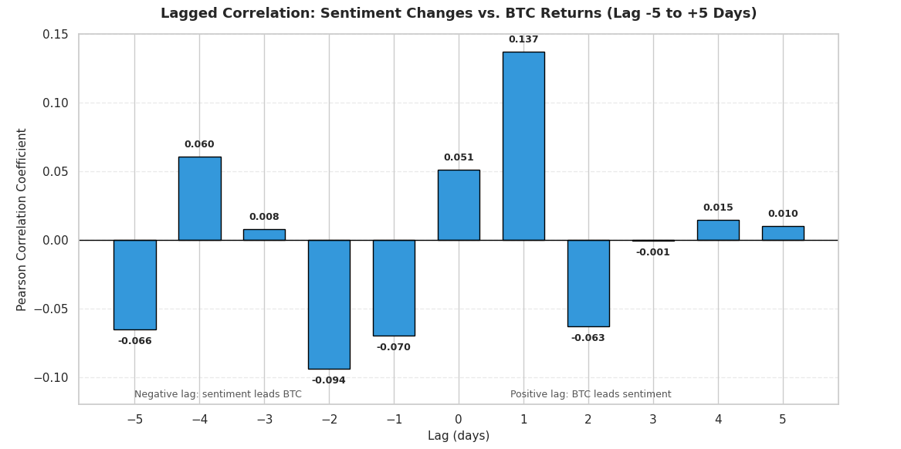

# ₿ Bitcoin Sentiment Analysis with PySpark
## 📌 Project Overview

This project explores the relationship between public sentiment expressed on Twitter and Bitcoin price movements during 2019.

Using PySpark, the analysis processes and cleans a large collection of tweets, applies sentiment analysis techniques, and combines the resulting sentiment indicators with historical Bitcoin market data.

The goal is to investigate whether changes in public opinion on social media are associated with Bitcoin price variations, and whether sentiment can provide useful insights into market behavior.

## 🗂️ Dataset
The project uses two main datasets:

**1. Bitcoin Tweets Dataset**
- Source: bitcoin_tweets .csv
- Contains tweets related to Bitcoin, including text, timestamps and engagement metrics such as likes, replies and retweets.

**2. Bitcoin Historical Price Dataset**
- Source: BTC-USD.csv
- Contains historical Bitcoin market information, including daily closing prices.

The analysis focuses particularly on 2019, allowing sentiment indicators to be compared with Bitcoin's historical price movements over the same period.

## 🎯 Project Objectives
- Process and clean a large dataset of Bitcoin-related tweets using PySpark.
- Identify the language of tweets and focus the analysis on English-language content.
- Apply sentiment analysis to classify tweets as positive, negative or neutral.
- Explore sentiment distribution and trends over time.
- Investigate user engagement through likes and replies.
- Combine social media sentiment indicators with Bitcoin historical prices.
- Analyze correlations and possible lead-lag relationships between sentiment and market movements.

## 🛠️ Tools & Techniques
**Programming Language**
- Python

**Big Data Processing**
- PySpark
- Spark SQL

**Data Analysis**
- Pandas
- NumPy
- SciPy

**Natural Language Processing**
- NLTK
- VADER Sentiment Analyzer
- langdetect

**Data Visualization**
- Matplotlib
- Seaborn

**Other Libraries**
- Requests

## 📂 Project Structure
## 🔄 Project Workflow
**1. Data Import and Initial Exploration**

The Twitter dataset is imported and processed using PySpark. An initial exploration is performed to understand its structure, inspect the available columns, identify missing values and detect duplicate tweet IDs.

**2. Data Cleaning and Preprocessing**

The dataset is cleaned by:
- Removing unnecessary columns.
- Eliminating duplicate tweets.
- Handling missing values.
- Converting timestamps into date fields.
- Standardizing numerical engagement metrics.

Tweet text is also cleaned by removing URLs and user mentions, replacing HTML entities, removing the `#` symbol while preserving hashtag words, and normalizing whitespace.

**3. Language Detection**

The `langdetect` library is used through a PySpark User Defined Function (UDF) to identify the language of each tweet.

The analysis is restricted to English-language tweets to ensure consistency in the sentiment analysis.

**4. Sentiment Analysis**

The VADER Sentiment Analyzer is applied to evaluate the emotional polarity of each tweet.

Tweets are classified according to their compound sentiment score:

- **Positive:** compound score ≥ 0.05
- **Negative:** compound score ≤ -0.05
- **Neutral:** compound score between -0.05 and 0.05

**5. Sentiment Distribution and Temporal Analysis**

The distribution of positive, negative and neutral tweets is examined to understand the overall public perception of Bitcoin.

Monthly and yearly trends are analyzed to identify changes in sentiment over time.

The analysis highlights a significant increase in tweet activity during April and May 2019, with positive tweets representing the largest sentiment category.

**6. User Engagement Analysis**

Likes and replies are analyzed to investigate how users interact with tweets expressing different sentiments.

The results suggest that:
- Negative tweets receive more average likes, indicating a higher level of passive engagement.
- Positive tweets receive more average replies, suggesting a greater tendency toward active interaction and discussion.

**7. Bitcoin Price Data Integration**

Historical Bitcoin price data is imported and processed.

Daily closing prices are extracted and filtered to focus on 2019. The resulting dataset is combined with daily sentiment indicators to enable a comparative analysis of social media activity and market behavior.

**8. Net Sentiment Index Calculation**

A daily Net Sentiment Index is calculated using the following formula:

**Net Sentiment Index (NSI) = (Positive Tweets - Negative Tweets) / Total Tweets**

The index ranges from -1 to +1:
- Values closer to +1 indicate predominantly positive sentiment.
- Values closer to -1 indicate predominantly negative sentiment.
- Values around 0 indicate a more balanced sentiment distribution.

**9. Correlation Analysis**

Pearson correlation coefficients are calculated to investigate linear relationships between:
- Bitcoin daily returns.
- Daily changes in sentiment.
- Net Sentiment Index.
- Daily tweet volume.

A correlation matrix is generated to provide an overview of the relationships among these variables.

**10. Lead-Lag Analysis**

A lead-lag correlation analysis is performed over a time window ranging from -5 to +5 days.

This approach investigates whether changes in public sentiment tend to precede Bitcoin price movements or whether market movements appear to influence sentiment.

The strongest positive correlation is observed at lag +1 (r = 0.136), while the lowest correlation is observed at lag -2 (r = -0.093).

Overall, the correlations are weak, suggesting that there is no strong linear relationship between daily sentiment changes and Bitcoin returns in the analyzed period.

## 💡 Business and Financial Insights
The analysis provides several interesting observations:

- **Public sentiment:** Positive tweets represent the largest sentiment category in the analyzed dataset.
- **User engagement:** Negative tweets tend to receive more likes, while positive tweets generate more replies.
- **Market relationship:** Daily sentiment indicators show only weak linear correlations with Bitcoin returns.
- **Lead-lag behavior:** The lead-lag analysis does not reveal a strong predictive relationship between social media sentiment and Bitcoin price movements.

These results show that data from social media can help us better understand how people perceive the market. However, sentiment indicators alone are not enough to explain market behavior.

## ⚠️ Limitations
Some methodological limitations should be considered:

- VADER is a lexicon-based sentiment analyzer and may not fully capture sarcasm, irony or context-specific expressions.
- Language detection may occasionally produce inaccurate classifications.
- Pearson correlation measures linear relationships and does not establish causation.
- The analysis focuses on a specific time period and does not necessarily represent behavior across different market conditions.
- Social media activity may not fully reflect the opinions of the entire Bitcoin investor community.

## 🎓 Conclusion
This project demonstrates how Big Data processing and Natural Language Processing techniques can be combined to explore the relationship between social media sentiment and cryptocurrency market behavior.

PySpark provides the framework for processing and transforming tweet data, while VADER enables sentiment classification and statistical analysis helps investigate potential relationships with Bitcoin price movements.

Although the results do not reveal a strong linear relationship between sentiment and daily Bitcoin returns, the project highlights the importance of combining different data sources to gain a broader understanding of financial markets.

It also provides practical experience in data engineering, text preprocessing, sentiment analysis, statistical analysis and data visualization.

## 📁 Repository Contents
- **[Bitcoin_Sentiment_Analysis_Based_on_Tweets.ipynb](Bitcoin_Sentiment_Analysis_Based_on_Tweets.ipynb):** Complete analysis, from data ingestion and preprocessing to sentiment classification, statistical analysis and visualization.
- **[images](images):** Graphs and visualizations generated throughout the project.
- **[DATA](DATA):**  Contains the two original datasets used in the project: Twitter data related to Bitcoin and historical Bitcoin market prices.

## 📸 Project Preview
The following visualizations summarize the main findings of the analysis.

### 1. Monthly Sentiment Trend
Shows the monthly distribution of positive, negative and neutral tweets over the analyzed period, highlighting changes in public sentiment over time.

### 2. Monthly Sentiment Analysis – 2019
Focuses on sentiment trends during 2019, highlighting the increase in tweet activity during April and May.

### 3. Average Engagement by Sentiment
Compares the average number of likes and replies across positive and negative tweets, revealing differences in user engagement.

### 4. Correlation Matrix
Illustrates the Pearson correlation coefficients between Bitcoin daily returns, sentiment changes, net sentiment and tweet volume.

### 5. Bitcoin Price and Sentiment Trends
Compares Bitcoin price movements with the daily Net Sentiment Index and its 7-day rolling average.

### 6. Daily Returns and Sentiment Changes
Explores the relationship between daily Bitcoin returns and daily changes in sentiment.

### 7. Lead-Lag Correlation Analysis
Examines correlations between sentiment changes and Bitcoin returns across different time lags, helping investigate potential temporal relationships.

## 📬 Contact
- **Silvia Venturini**
- [LinkedIn](https://www.linkedin.com/in/silvia-venturini92/)
- **Email:** silvia.venturini92@hotmail.com
